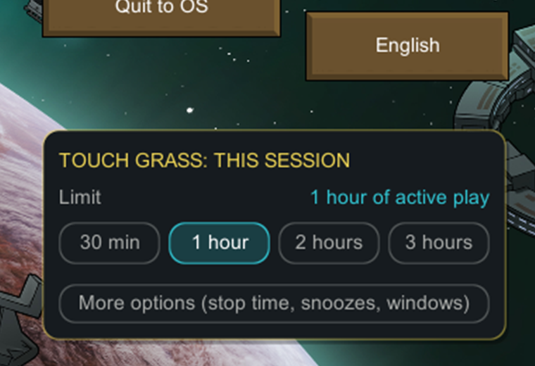

# Touch Grass: Playtime Limiter

A playtime limiter for RimWorld.

Touch Grass sets a limit on how long you play RimWorld. The session timer
starts only once a colony is playable, so startup and save loading don't count
against you. You can limit play by duration or by a real-world stop time, and
the limit locks in once play begins. When time runs out, a decision window lets
you take one to three five-minute snoozes. You can also restrict play to as
many as three daily time windows.

- Pick this session's limit from a panel on the main menu, before a colony loads.
- A small timer with a progress meter sits above RimWorld's clock (both can be turned off).
- At the deadline the game pauses; you autosave and quit, or snooze.

## Install

Subscribe on the Steam Workshop, or copy `About`, `1.6`, `1.7`, `Languages` and
`LICENSE` into a new folder under `RimWorld/Mods/`.
Requires [Harmony](https://steamcommunity.com/sharedfiles/filedetails/?id=2009463077).
Not compatible with Zetrith's Multiplayer or Manulinkraft's It's time to STOP.

## Development

### Building from source

`Build.ps1` builds `<version>\Assemblies` for the installed game, so run it once
for 1.6 and once for 1.7. It uses the Windows `csc` (C# 5, no SDK) and Workshop
Harmony; pass `-RimWorldDir` for a non-standard install.
`tools\MakeWorkshopRelease.ps1` recreates the upload folder in `Mods`.

## Credits

Uses [Harmony](https://github.com/pardeike/Harmony) by Andreas Pardeike (MIT) as a
declared dependency; it is not bundled.

Released under the WTFPL (see `LICENSE`): do what you want with it. If you reuse or
fork it, a mention of me would be appreciated, and please don't re-upload it
unchanged. Third-party notices are in `NOTICE.md`.

## Legal

Portions of the materials used to create this content/mod are trademarks and/or copyrighted works of Ludeon Studios Inc. All rights reserved by Ludeon. This content/mod is not official and is not endorsed by Ludeon.
